# ShareFolder

ShareFolder adalah aplikasi berbagi file internal berbasis Go, SQLite, dan penyimpanan filesystem. Tersedia ruang pribadi, kantor, dan divisi; upload yang dapat dilanjutkan; berbagi internal; preview PDF/gambar; tempat sampah; audit; serta administrasi. Antarmuka menyediakan bahasa Indonesia/English dan tema Light/Dark.

<p align="center">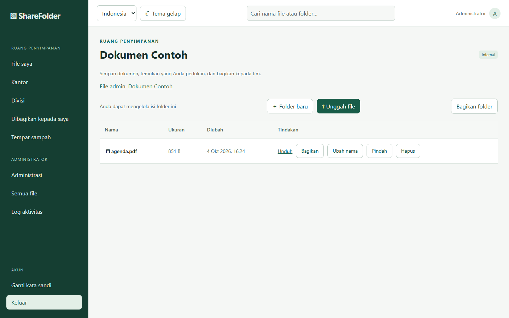</p>

## Instalasi baru di Ubuntu

Panduan ini untuk **Ubuntu 24.04 amd64**, IP tetap pada server, RAM minimal 4 GB, dan sedikitnya 5 GiB ruang kosong. Contoh memakai IP `10.10.1.10`; ganti dengan IP yang benar-benar terpasang pada server Anda. Perintah dijalankan di server melalui terminal Bash.

1. Pasang alat dasar dan clone repo.

   ```bash
   sudo apt-get update
   sudo apt-get install -y git curl ca-certificates openssl python3 iproute2
   git clone https://github.com/enginestop/sharefolder-v1.git
   cd sharefolder-v1
   ```

2. Pasang Go 1.27.1 untuk Linux amd64 di direktori terpisah. Checksum berikut berasal dari [halaman unduhan resmi Go](https://go.dev/dl/).

   ```bash
   curl -fsSLo /tmp/go1.27.1.linux-amd64.tar.gz https://go.dev/dl/go1.27.1.linux-amd64.tar.gz
   echo '63d339f0da5ab53635a56f2490a7984dfe12dfcff22ad749f63edaf590168445  /tmp/go1.27.1.linux-amd64.tar.gz' | sha256sum -c -
   sudo install -d -m 0755 /opt/sharefolder-toolchain
   if [ ! -e /opt/sharefolder-toolchain/go ]; then
     sudo tar -C /opt/sharefolder-toolchain -xzf /tmp/go1.27.1.linux-amd64.tar.gz
   fi
   /opt/sharefolder-toolchain/go/bin/go version
   ```

   Versi yang ditampilkan harus `go1.27.1 linux/amd64`. Installer menolak versi lain.

3. Bangun dan pasang aplikasi. Ganti `10.10.1.10` dengan IP server Anda.

   ```bash
   sudo bash deployment/install-ubuntu.sh 10.10.1.10
   ```

   Installer menguji source, membangun binary, menyiapkan direktori `/opt/sharefolder`, membuat sertifikat HTTPS untuk IP tersebut, menjalankan `doctor` dan migrasi SQLite, membuat service systemd, lalu memeriksa endpoint kesehatan. Pada **pemasangan baru saja**, installer membuat akun berikut:

   | URL | Username | Password |
   | --- | --- | --- |
   | `https://10.10.1.10` | `admin` | `admin` |

   Buka URL dari browser setelah sertifikat lokal dipercaya. Password awal ini diketahui publik; ganti melalui menu **Ganti kata sandi** sebelum menyimpan data nyata. Penggantian password bersifat opsional di aplikasi. Menjalankan installer ulang mempertahankan database, file, sertifikat, dan akun yang sudah ada; password yang pernah diganti tidak dikembalikan menjadi `admin`.

4. Jika UFW aktif, izinkan HTTPS hanya dari subnet yang Anda gunakan. Contoh LAN:

   ```bash
   sudo ufw allow from 10.10.1.0/24 to any port 443 proto tcp
   ```

   Periksa service dan HTTPS dengan sertifikat publik origin:

   ```bash
   sudo systemctl status sharefolder --no-pager
   sudo curl --cacert /opt/sharefolder/config/tls/server.crt https://10.10.1.10/health/ready
   ```

   Respons yang diharapkan: `{"status":"ready"}`. Sertifikat awal ditandatangani sendiri, sehingga browser klien perlu mempercayai **sertifikat publik** `server.crt`. Jangan salin `server.key` ke klien.

## Akses dengan Cloudflare Tunnel

Publikasikan domain Anda melalui route Cloudflare Tunnel ke `https://IP-SERVER:443` dan pertahankan header `Host` asli. Domain tidak perlu didaftarkan dalam konfigurasi ShareFolder; domain baru yang valid langsung dapat dipakai setelah route dan DNS Cloudflare aktif. Request yang mengubah data tetap harus mengirim `Origin` HTTPS yang cocok dengan domain tersebut. Untuk sertifikat origin lokal, atur [CA Pool pada koneksi Tunnel](https://developers.cloudflare.com/cloudflare-one/networks/connectors/cloudflare-tunnel/configure-tunnels/origin-parameters/) menggunakan sertifikat publik `server.crt`.

## Operasi

```bash
sudo systemctl status sharefolder
sudo systemctl restart sharefolder
sudo journalctl -u sharefolder --since today
```

Metadata SQLite berada di `/opt/sharefolder/state`, file di `/opt/sharefolder/data`, dan konfigurasi di `/opt/sharefolder/config/sharefolder.env`. `data/blobs` dan `data/staging` harus berada pada filesystem yang sama. Salin state dan data secara konsisten saat membuat backup. Build memakai versi dependensi yang dikunci di `go.mod`/`go.sum`; frontend dan PDF.js tertanam dalam binary tanpa CDN.

## Tampilan aplikasi

Semua gambar berikut diambil dari **fixture demo lokal**, bukan akun atau berkas server produksi. Klik gambar untuk melihat ukuran penuh.

| Login | File saya |
| --- | --- |
| [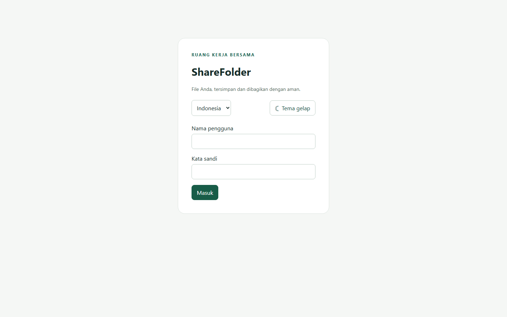](docs/screenshots/01-login.png) | [](docs/screenshots/02-file-saya.png) |

| Preview PDF | Ruang kantor |
| --- | --- |
| [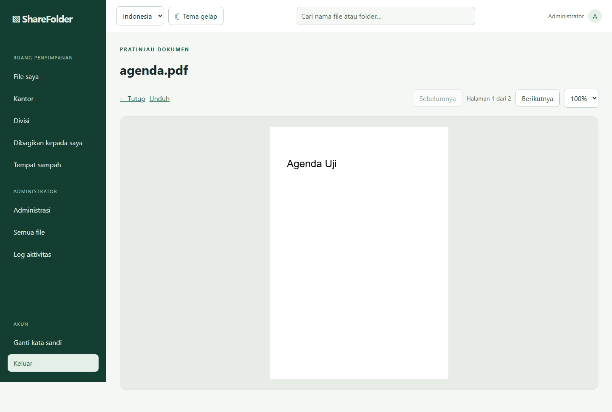](docs/screenshots/03-pratinjau-pdf.png) | [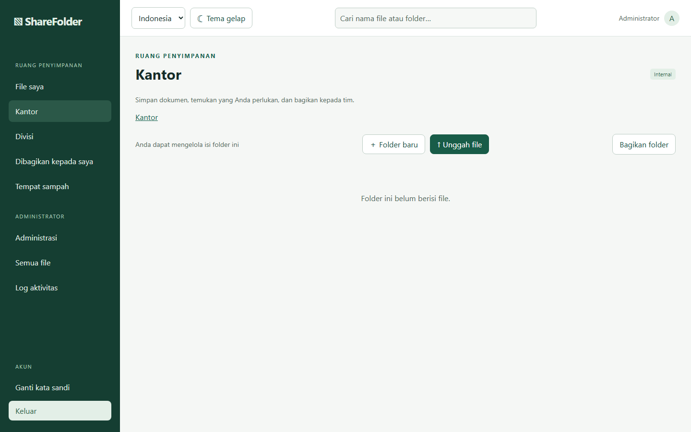](docs/screenshots/04-kantor.png) |

| Ruang divisi | Dibagikan kepada saya |
| --- | --- |
| [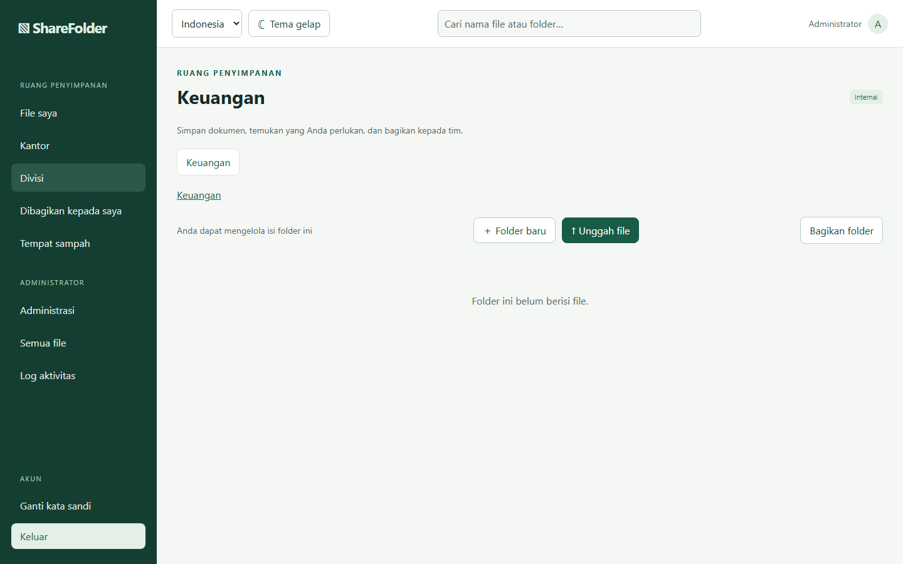](docs/screenshots/05-divisi.png) | [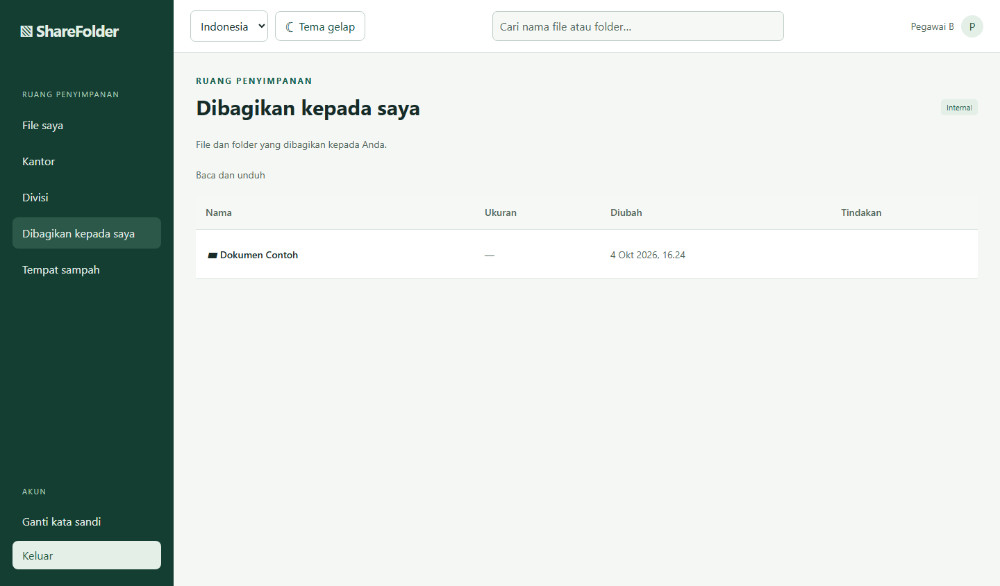](docs/screenshots/06-dibagikan.png) |

| Tempat sampah | Ganti kata sandi |
| --- | --- |
| [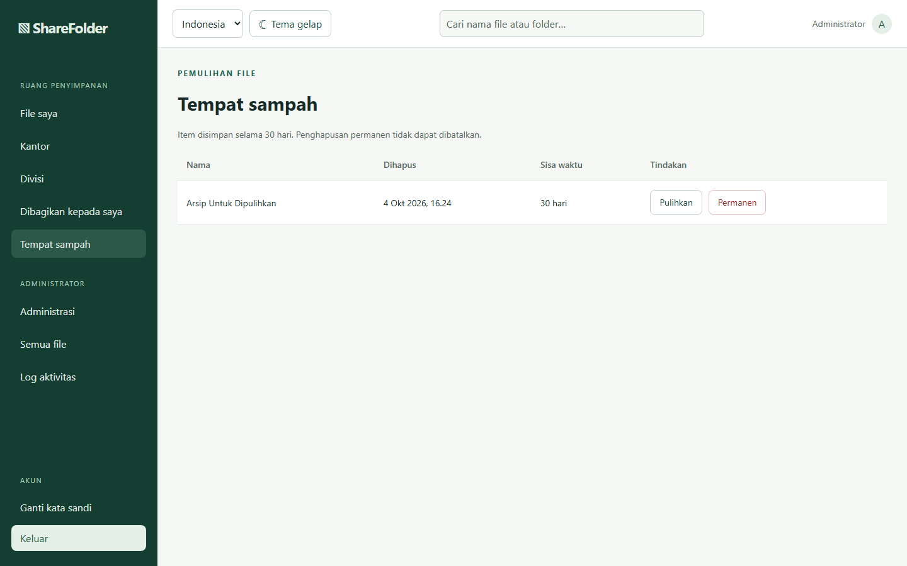](docs/screenshots/14-tempat-sampah.png) | [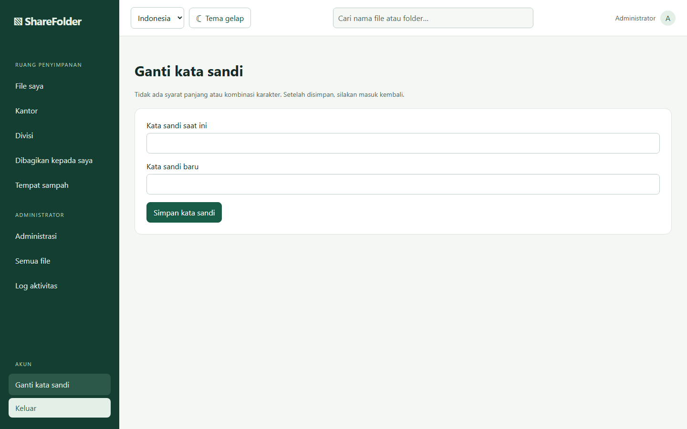](docs/screenshots/13-ganti-kata-sandi.png) |

### Administrasi

| Pengguna | Grup |
| --- | --- |
| [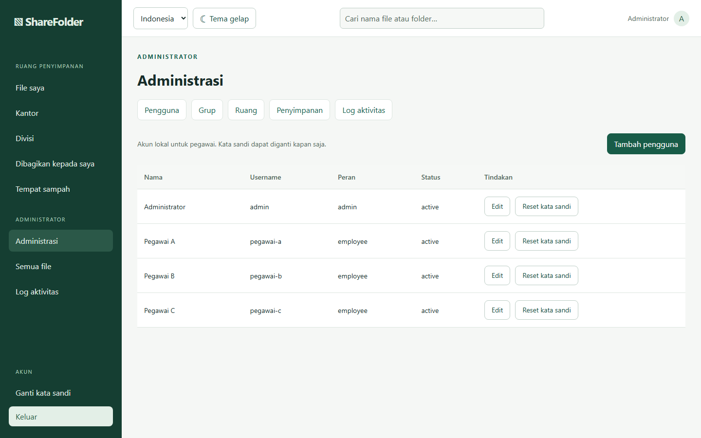](docs/screenshots/07-admin-pengguna.png) | [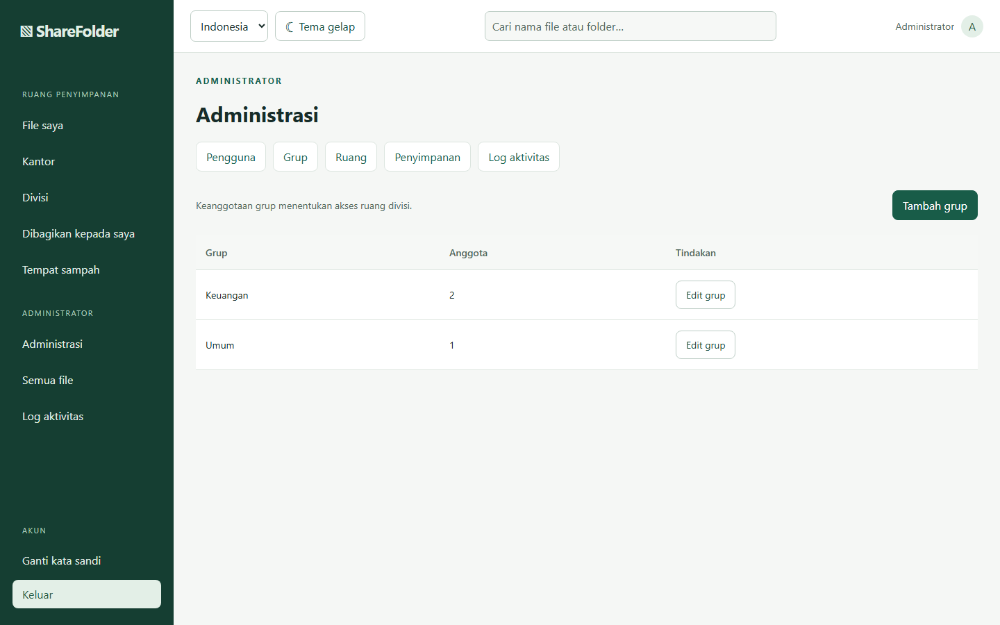](docs/screenshots/08-admin-grup.png) |

| Ruang | Kapasitas |
| --- | --- |
| [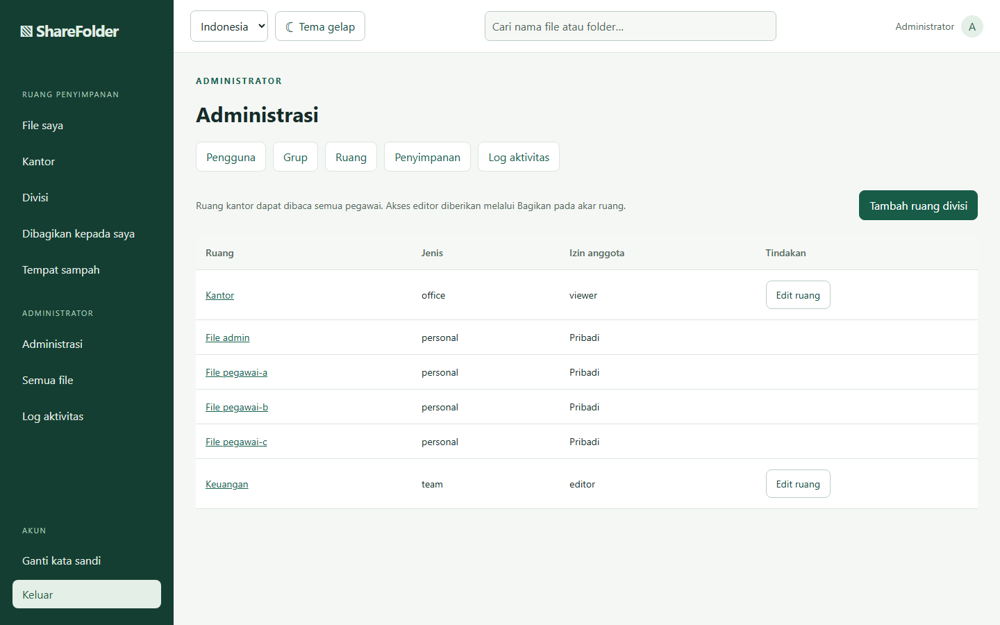](docs/screenshots/09-admin-ruang.png) | [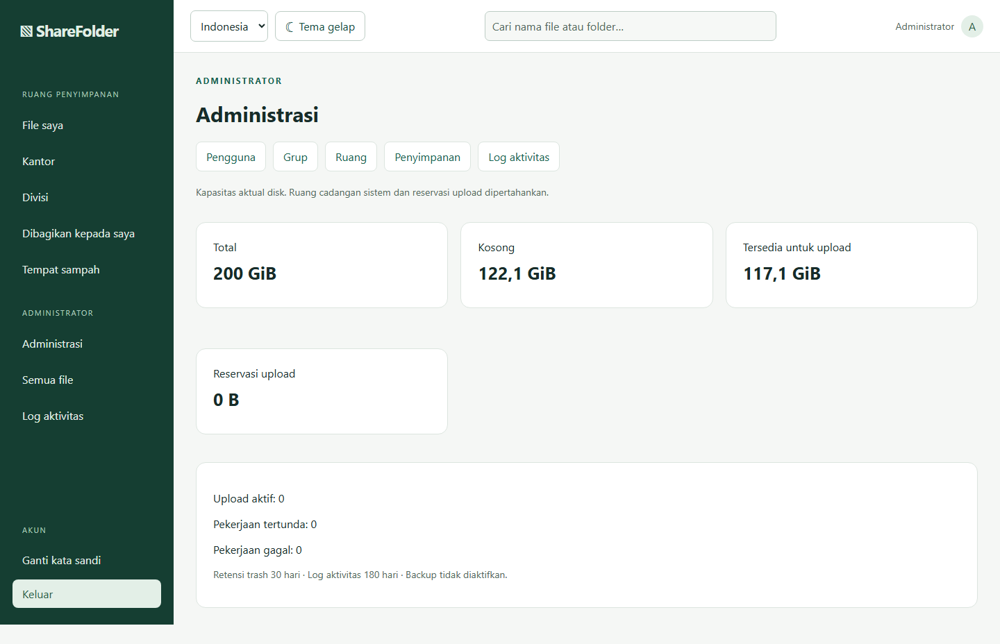](docs/screenshots/10-admin-kapasitas.png) |

| Semua file | Log aktivitas |
| --- | --- |
| [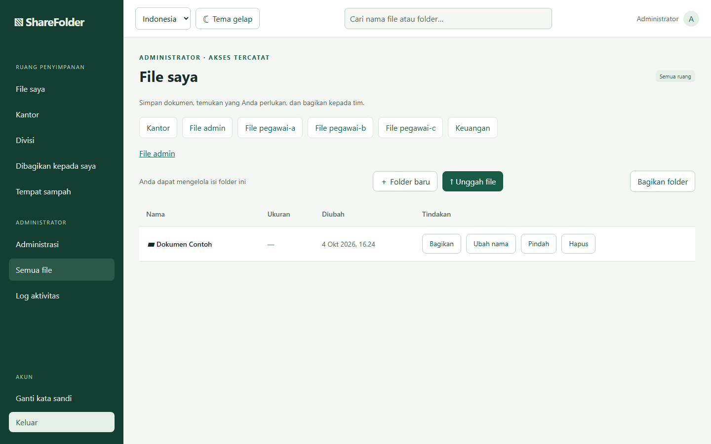](docs/screenshots/11-semua-file.png) | [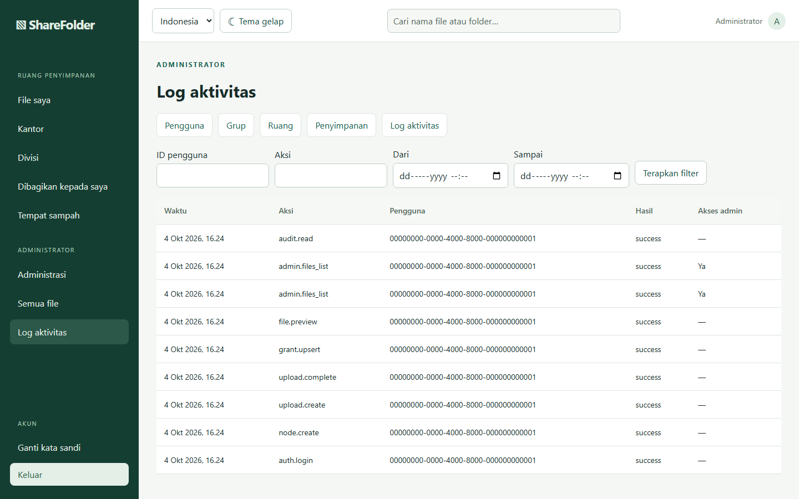](docs/screenshots/12-log-aktivitas.png) |

### Ponsel dan tema

| File saya di ponsel | Administrasi di ponsel | Tema gelap |
| --- | --- | --- |
| [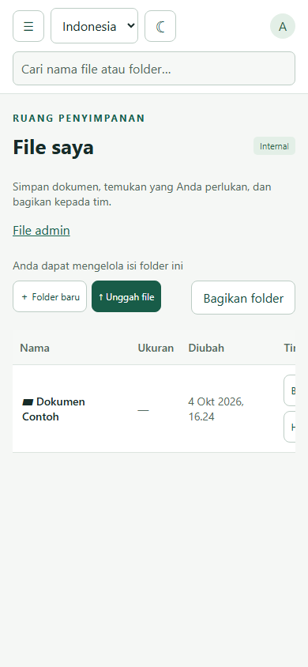](docs/screenshots/15-mobile-file-saya.png) | [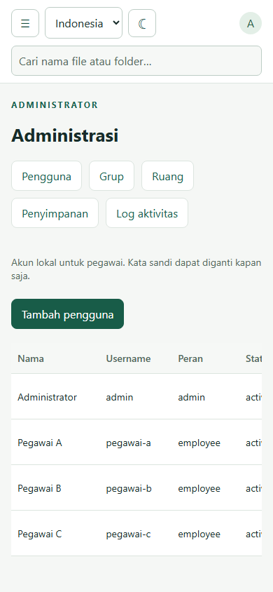](docs/screenshots/16-mobile-admin.png) | [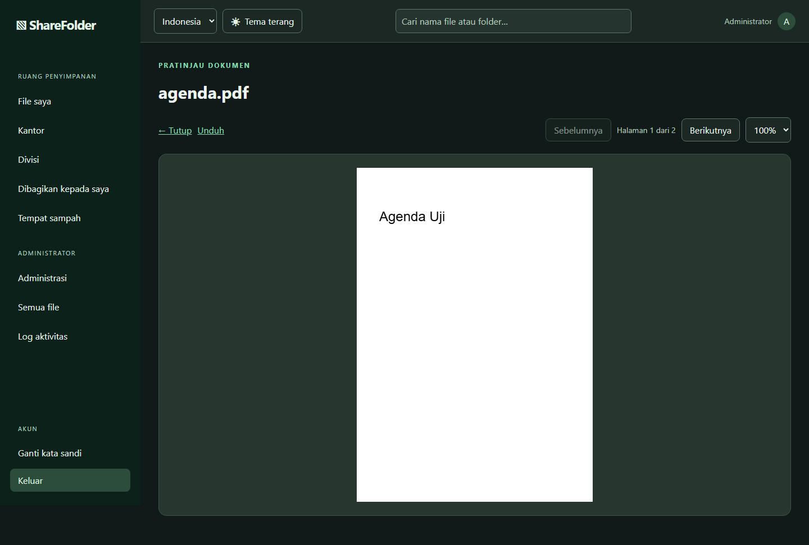](docs/screenshots/17-tema-gelap.png) |
